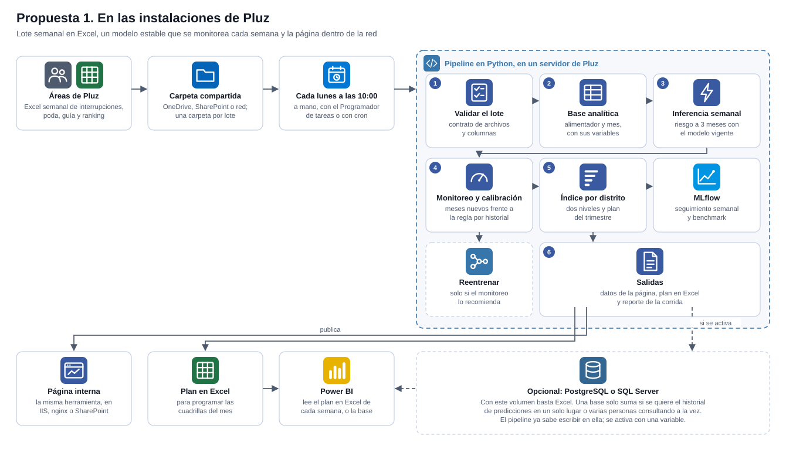
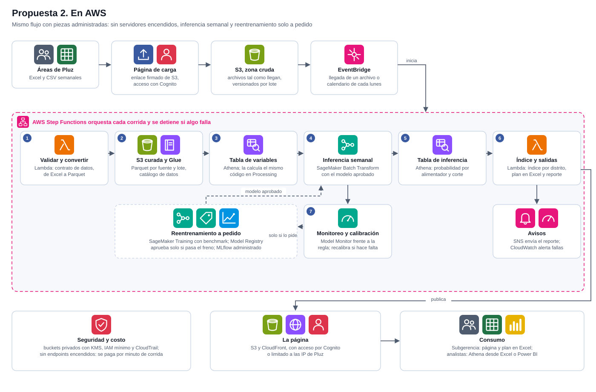

# Arquitectura para la actualización continua del modelo y de la herramienta

Pluz Energía pidió en la reunión N°3 conocer el proceso de automatización propuesto para actualizar el modelo y el tablero con la data que la empresa envía cada semana. Este documento presenta dos propuestas que comparten el mismo diseño de etapas: una en las instalaciones de Pluz y otra en AWS. Las dos usan el pipeline que ya funciona en este repositorio, de modo que pasar de una a otra no exige reescribir la lógica.

## 1. El punto de partida

Tres hechos deciden la arquitectura:

1. **El volumen es pequeño.** Unas 200 interrupciones al mes, unos cuantos cientos de podas al mes y una guía de unas 14.000 subestaciones. Todo el histórico cabe en menos de 20 MB y el cálculo completo tarda segundos.
2. **La data llega por lotes semanales**, en Excel. No hace falta procesar en tiempo real.
3. **El equipo de Pluz trabaja en Excel.** La solución tiene que respetar esa forma de trabajo: el área entrega un Excel y recibe una página, un Excel con el plan y, si quiere, una base de datos para consultar.

## 2. Lo que comparten las dos propuestas

**Las mismas etapas.** Validar el lote, construir la base analítica, inferir, entrenar cuando corresponde, calcular el índice y publicar. Son las etapas del pipeline de la carpeta pipeline, documentadas en pipeline/README.md.

**Un modelo estable, monitoreado cada semana.** El modelo no se reentrena por calendario: se entrena una vez y queda como modelo vigente, con una ficha que registra sus variables, los meses con que se entrenó y cómo rindió fuera de muestra. Cada semana predice con ese modelo y lo monitorea en los meses que ya tienen su ventana de tres meses completa y que no vio al entrenarse. Se miden dos cosas. La primera es si sigue ordenando al menos tan bien como la regla por historial. La segunda es si su probabilidad sigue calibrada, es decir, si la frecuencia observada se parece a la probabilidad promedio que declara.

**Recalibrar en vez de reentrenar.** Si la probabilidad se descalibra, por ejemplo porque cambió la frecuencia de cortes, se ajusta solo su escala con una recalibración logística sobre los meses nuevos. El orden del ranking no cambia, así que el índice y el plan tampoco: lo único que cambia es que el riesgo a tres meses vuelve a leerse como una frecuencia real. El reentrenamiento queda para cuando el monitoreo muestra que el ordenamiento cayó frente a la regla por historial, y se hace con una orden explícita, después de revisar qué cambió en los datos. Se probó con un modelo entrenado hasta enero de 2026 y medido en los cuatro meses siguientes: siguió ordenando mejor que la regla y dentro de la banda de calibración, sin pedir nada.

**Un freno antes de publicar un modelo nuevo.** Cuando se reentrena, el modelo nuevo se mide fuera de muestra contra la regla por historial. Si queda más de 10 puntos de cobertura por debajo, no se guarda ni se publica y se avisa. En AWS ese freno es la aprobación del registro de modelos.

**Historial para medir aciertos.** Cada predicción y cada índice se guardan con su fecha. Es lo que permitirá responder, tres meses después, si el plan acertó, que es el indicador de éxito que falta acordar con Pluz.

**Seguimiento con MLflow.** Cada corrida semanal queda registrada en MLflow con las métricas de monitoreo del modelo vigente, y el benchmark de modelos registra cada comparación. Así se ve, semana a semana, si el modelo sigue ordenando mejor que la regla y si su probabilidad sigue calibrada. En las instalaciones se usa MLflow local; en AWS, el MLflow administrado de SageMaker.

## 3. Propuesta 1: en las instalaciones de Pluz

El paso a paso de instalación, de la corrida semanal, manual o programada, y de la demostración con datos reales está en docs/GUIA_PROPUESTA_1.md.

### Componentes

1. **Entrada.** Una carpeta compartida en OneDrive, SharePoint o una unidad de red. El área deja ahí el Excel semanal, en una subcarpeta con la fecha del lote. Es lo único que cambia en su forma de trabajo.
2. **Proceso.** El pipeline de este repositorio, instalado en un servidor o en un computador de la Subgerencia, que corre cada lunes a las 10:00, a mano con doble clic o programado con el Programador de tareas de Windows o con cron. Lo que se ejecuta es pipeline/programar/actualizar_semanal.bat, o el .sh en Linux, que llama a python pipeline/actualizar.py semanal.
3. **Almacenamiento: Excel, y una base de datos solo si hace falta.** Con este volumen, menos de 20 MB en todo el histórico, cada corrida deja el plan en un libro de Excel que el área usa directamente y que Power BI puede leer. Una base de datos es **opcional**: suma solo si se quiere el historial de predicciones en un solo lugar o varias personas consultando a la vez. En ese caso, PostgreSQL con PostGIS es gratuito y estándar, y SQL Server Express es equivalente si el área de sistemas trabaja con Microsoft. El pipeline ya escribe en cualquiera de los dos cambiando solo una variable.
4. **Consumo.** La página, servida dentro de la red de Pluz en un servidor web interno o en SharePoint; el plan en Excel para programar cuadrillas; y Power BI leyendo ese mismo Excel, o la base de datos si se activa, para cruzar la información con otras planillas.

### Lo que ya está listo y lo que pone Pluz

Está listo en este repositorio: el pipeline completo con validación, modelo vigente, monitoreo, recalibración, freno y reporte; el plan en Excel; la escritura en base de datos, probada con SQLite; el benchmark con MLflow; y esta documentación. Pluz pone el servidor o computador, la carpeta compartida, el sitio interno donde se sirve la página y, solo si la quiere, una base de datos.

### Ventajas y límites

Es la opción más rápida de poner en marcha, no tiene costo de licencias y los datos no salen de la empresa. Su límite es que depende de un equipo encendido y de que alguien revise el reporte cuando una corrida no publica.

## 4. Propuesta 2: en AWS

El paso a paso de construcción y de operación semanal está en docs/GUIA_PROPUESTA_2.md.

### La propuesta base

Un bucket de S3 recibe todos los Excel y CSV que envía Pluz. Desde ahí, Athena carga dos tablas: una con la ingeniería de variables y otra con la inferencia. El entrenamiento de los modelos se hace en SageMaker.

### Mejoras sobre la propuesta base

1. **Athena no lee Excel.** Hace falta un paso que convierta cada Excel a Parquet. Una función Lambda lo hace al llegar el archivo, y en el mismo paso valida el contrato de datos que hoy valida el pipeline. Si el lote no cumple, la corrida se detiene antes de tocar nada.
2. **Dos zonas en S3.** Una zona cruda guarda los archivos tal como llegan, con versionado, para poder reconstruir cualquier corrida. Una zona curada guarda el Parquet validado, particionado por fuente y por lote, y registrado en el catálogo de AWS Glue, que es lo que Athena consulta.
3. **Un orquestador.** La propuesta base no dice qué dispara cada paso. EventBridge inicia la corrida al llegar un archivo, o cada lunes, y AWS Step Functions ejecuta las etapas en orden, reintenta lo que falla y se detiene si algo no cumple.
4. **La tabla de variables sin reescribir la lógica.** La ingeniería de variables ya existe en Python y está probada. La forma más segura de llevarla a Athena es correr ese mismo código en un trabajo de SageMaker Processing que escribe la tabla en Parquet y la registra en el catálogo: la tabla existe en Athena, pero se calcula con el código validado. Reescribirla en SQL es posible con funciones de ventana, y conviene solo si los analistas de Pluz quieren modificar las variables; en ese caso hay que comparar ambas versiones sobre un mismo corte antes de cambiar.
5. **Dos tablas más, pequeñas.** Además de la de variables y la de inferencia, una tabla con el índice por distrito y otra con el registro de corridas y sus métricas. Sin ellas no hay forma de saber qué plan se publicó cada semana ni de medir después si acertó.
6. **Monitoreo semanal y reentrenamiento a pedido, no por calendario.** SageMaker Model Monitor mide cada semana el modelo vigente en los meses nuevos con resultado, frente a la regla por historial, y una función recalibra la probabilidad si se sale de la banda. El entrenamiento en SageMaker Training, con el benchmark, solo se dispara cuando el monitoreo lo recomienda, y el modelo nuevo solo queda aprobado en Model Registry si supera el freno. Las métricas se registran en el MLflow administrado de SageMaker.
7. **Inferencia por lotes, sin endpoint.** La predicción semanal se hace con Batch Transform o con un trabajo de Processing. Un endpoint en tiempo real estaría encendido todo el mes para usarse unos segundos por semana.
8. **Publicación y avisos.** Una Lambda calcula el índice, escribe los datos de la página y el plan en Excel, y SNS envía por correo el reporte de la corrida. CloudWatch avisa si una etapa falla.
9. **La página con acceso restringido.** Se sirve desde S3 con CloudFront, con acceso por Cognito o limitado a las direcciones IP de Pluz, porque muestra direcciones de subestaciones y número de clientes.
10. **Una carga sencilla para el área.** Nadie de Pluz debería entrar a la consola de AWS. Una página de carga con enlaces firmados de S3 basta para subir el Excel semanal.
11. **Infraestructura como código.** Todo el diseño se describe en CloudFormation o Terraform, de modo que se puede crear, revisar y reproducir en otra cuenta sin pasos manuales.

### Seguridad, costo y ubicación de los datos

Los buckets son privados y cifrados con KMS, cada servicio tiene solo los permisos que necesita y CloudTrail registra cada acceso. No hay servidores encendidos: Lambda, Athena, Step Functions y los trabajos de SageMaker se pagan por uso, y con este volumen el costo mensual es bajo: la inferencia y el monitoreo semanales duran minutos, y el entrenamiento solo ocurre cuando el monitoreo lo pide. AWS no tiene una región en el Perú, de modo que los datos quedarían en la región más cercana, São Paulo, o en Norte de Virginia. Pluz debe confirmar que su política de datos lo permite.

## 5. Comparación

* **Costo.** En las instalaciones, sin licencias si se usa PostgreSQL, sobre equipos que Pluz ya tiene. En AWS, pago por uso, bajo pero recurrente.
* **Puesta en marcha.** En las instalaciones, días: el pipeline ya funciona. En AWS, semanas: hay que crear la cuenta, los permisos y la infraestructura, y pasar la revisión de seguridad de la empresa.
* **Operación.** En las instalaciones, depende de un equipo encendido y de una persona que lea el reporte. En AWS, se reintenta y avisa sola.
* **Datos.** En las instalaciones, no salen de la empresa. En AWS, quedan en otra región y requieren aprobación.
* **Escala.** Las dos alcanzan para la concesión completa con este volumen. AWS conviene si la herramienta pasa a datos diarios o a varias áreas.

## 6. Recomendación

1. **Hoy, durante el curso.** El pipeline en el repositorio, corrido a mano con cada lote y publicado en GitHub Pages para el testeo.
2. **Puesta en operación del piloto.** La propuesta en las instalaciones de Pluz: es la más rápida, no tiene costo y mantiene los datos en la empresa.
3. **Escala a toda la concesión.** La propuesta en AWS, si la herramienta se extiende a toda la concesión con datos más frecuentes, o antes si el área de sistemas de Pluz ya trabaja con AWS.

El paso de una a otra es directo porque las etapas son las mismas:

* Validar el lote pasa de pipeline/etapas/fuentes.py a la Lambda de validación y conversión.
* La base analítica pasa de pipeline/etapas/base_analitica.py al trabajo de Processing que escribe la tabla de variables en Athena.
* El modelo vigente, su monitoreo y su recalibración pasan de pipeline/etapas/modelo.py a SageMaker Model Monitor; el reentrenamiento a pedido y el benchmark, a SageMaker Training con Model Registry.
* La inferencia pasa a Batch Transform y queda en la tabla de inferencia de Athena.
* El índice y las salidas pasan de pipeline/etapas/indice.py y salidas.py a la Lambda de publicación.
* El Programador de tareas de Windows pasa a EventBridge y Step Functions.
