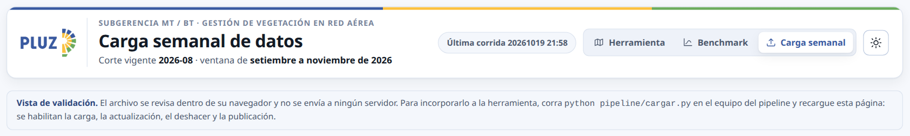
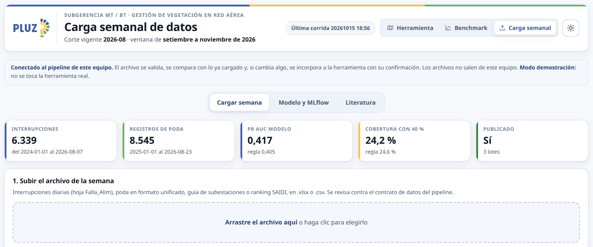
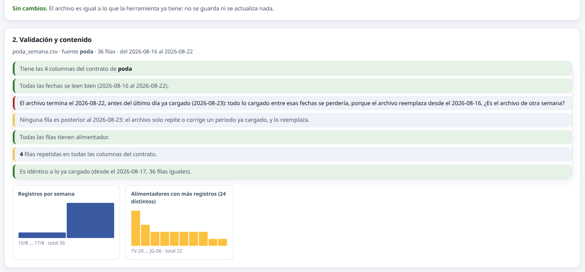
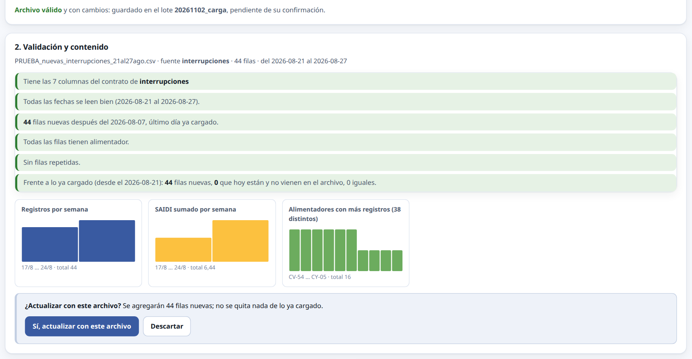
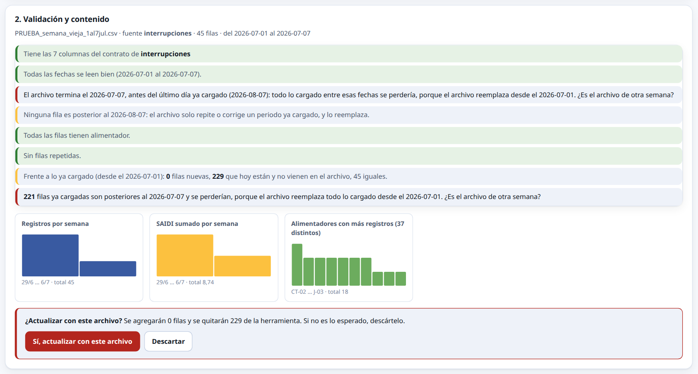
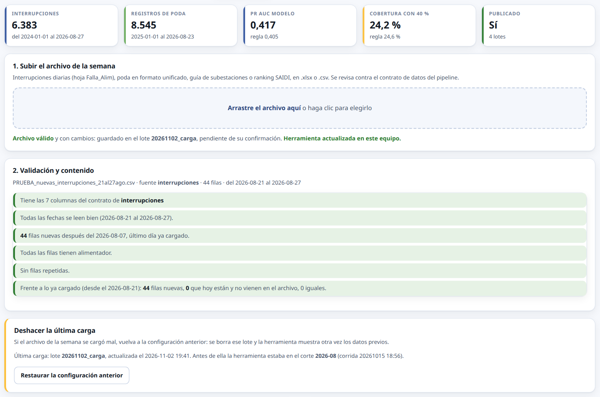
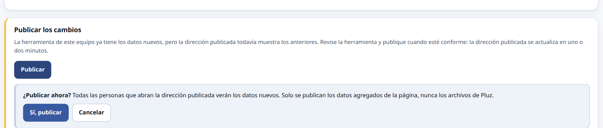
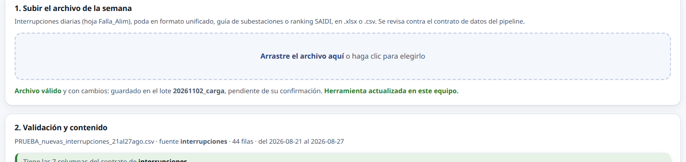
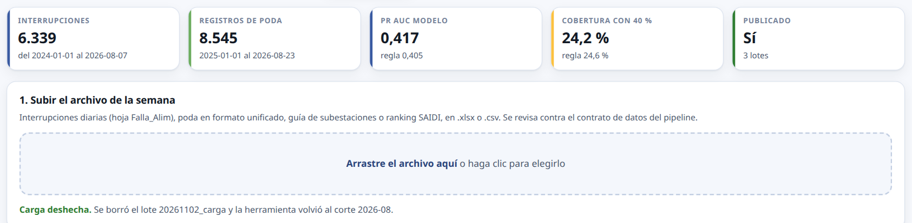

# Guía de la carga semanal

Cómo incorporar el archivo de cada semana a la herramienta desde el navegador, cómo probarlo sin tocar los datos reales, cómo deshacer una carga y qué hacer si algo falla.


## 1. Las tres formas de abrir la Carga semanal

La Carga semanal es la tercera página de la herramienta, junto a Herramienta y Benchmark. Lo que permite hacer depende de si el pipeline está corriendo en el equipo:

| Cómo se abre | Qué se puede hacer |
|---|---|
| Dirección publicada, sin el pipeline corriendo | Solo revisar el archivo dentro del navegador. No se envía a ningún lado ni cambia nada. |
| Dirección publicada, con python pipeline/cargar.py corriendo en el mismo equipo | Todo: revisar, comparar con lo ya cargado, actualizar, deshacer y publicar. |
| http://127.0.0.1:8050/cargar/, con python pipeline/cargar.py corriendo | Lo mismo que la anterior, sin pasar por la dirección publicada. |

El aviso debajo de la cabecera dice siempre en qué forma está la página. Sin el pipeline dice «Vista de validación»:



Con el pipeline dice «Conectado al pipeline de este equipo», o «Modo local» si se abrió en 127.0.0.1. En modo demostración lo agrega al final:



Los archivos de Pluz nunca salen del equipo: la página publicada solo habla con el programa de ese mismo equipo, y ese programa solo acepta pedidos de la dirección publicada y de sí mismo.


## 2. Antes de empezar, una sola vez por equipo

1. Tener una copia del proyecto e instalar las bibliotecas:
   ```
   python pipeline/actualizar.py instalar
   ```
2. Copiar desde el equipo donde ya corre el pipeline las carpetas **pipeline/datos**, con los lotes de Pluz, y **pipeline/salidas**, con el modelo vigente. No vienen con la copia del proyecto porque nunca se publican.
3. Para el botón Publicar: que el equipo tenga guardadas las credenciales con permiso para publicar. Sin ellas, todo lo demás funciona y solo Publicar falla (ver la sección 7).
4. Armar los archivos de prueba, si se va a seguir esta guía:
   ```
   python pipeline/demo/archivos_de_prueba.py
   ```
   Quedan en pipeline/datos/prueba:

   | Archivo | Qué simula | Qué tiene que pasar |
   |---|---|---|
   | PRUEBA_misma_semana.csv | Reenviar la última semana ya cargada | «Sin cambios»: no hace nada |
   | PRUEBA_semana_nueva.csv | Una semana nueva, con fechas posteriores a lo cargado. **Es ficticia**: la última semana corrida siete días | Filas nuevas, ninguna quitada: confirmación en azul |
   | PRUEBA_correccion_1fila.csv | Una corrección de la última semana | Una fila nueva: confirmación en azul |
   | PRUEBA_semana_vieja.csv | Un archivo equivocado, de un mes antes | Aviso en rojo: se perderían las filas posteriores |
   | PRUEBA_poda_misma_semana.csv | Reenviar la última semana de poda | «Sin cambios» |


## 3. Probar en modo demostración, sin tocar nada real

El modo demostración trabaja sobre una copia propia de los datos, en pipeline/datos/demo: sus lotes, su modelo y su herramienta. No toca la herramienta real y no permite publicar.

1. Si la demostración no existe todavía, armarla:
   ```
   python pipeline/demo/preparar_demo.py
   ```
2. Levantar el pipeline en modo demostración y abrir la Carga semanal en la dirección publicada:
   ```
   PLUZ_DEMO=$PWD/pipeline/datos/demo python pipeline/cargar.py publicado
   ```
   En Windows, en PowerShell: `$env:PLUZ_DEMO="$PWD\pipeline\datos\demo"; python pipeline/cargar.py publicado`.
   Se abre el navegador; el aviso tiene que decir «Conectado al pipeline de este equipo… Modo demostración».
3. Seguir los pasos de la sección 5 con los archivos de prueba.

En la demostración las interrupciones llegan solo hasta el 7 de agosto de 2026, así que PRUEBA_misma_semana.csv aparece como semana nueva. Para ver «Sin cambios» en la demostración se usa el de poda.

Al terminar, cerrar con Ctrl y C. Si la demostración quedó con cargas a medias, se rehace desde cero:
```
python pipeline/demo/preparar_demo.py borrar
python pipeline/demo/preparar_demo.py
```


## 4. Usar con los datos reales, desde la dirección publicada

```
python pipeline/cargar.py publicado
```

Abre la Carga semanal en la dirección publicada, conectada al pipeline de este equipo. Sin la palabra publicado se abre en http://127.0.0.1:8050/cargar/, con las mismas funciones. Mientras se usa, la ventana de la terminal tiene que quedar abierta; se cierra con Ctrl y C al terminar.

Los mensajes que empiezan con Gtk-Message al abrir el navegador son avisos del sistema y no afectan en nada.

**Con los datos reales, la semana ficticia (PRUEBA_semana_nueva.csv) se puede probar, pero hay que deshacerla con «Restaurar» al terminar y no publicarla.** Los demás archivos de prueba no cambian nada si se descartan.


## 5. Paso a paso de una carga

### Paso 1. Subir el archivo

Arrastrar el archivo de la semana al recuadro, o hacer clic y elegirlo. Acepta .xlsx y .csv: interrupciones diarias, poda en formato unificado, guía de subestaciones o ranking SAIDI.

### Paso 2. Primera verificación: el archivo

La página revisa el archivo y muestra una lista de controles: columnas pactadas, fechas legibles y futuras, filas nuevas frente al último día ya cargado, archivos que terminan antes de lo ya cargado, filas sin alimentador, filas repetidas y SAIDI negativo. Debajo, gráficos chicos con lo que trae: registros por semana, SAIDI por semana y alimentadores con más registros.

En verde lo que está bien, en amarillo los avisos y en rojo lo que impide seguir o merece atención.

### Paso 3. Segunda verificación: frente a lo ya cargado

El pipeline vuelve a revisar el archivo y lo compara con lo que la herramienta ya tiene. Esto importa porque **un archivo nuevo reemplaza todo lo cargado desde su primera fecha**.

**Si el archivo es igual a lo que ya está**, no se hace nada: no se guarda ni se actualiza.



**Si trae fechas nuevas**, la página dice cuántas filas se agregan y pide confirmación. El botón va en azul porque no se quita nada.



**Si quitaría filas**, el botón va en rojo. Si además el archivo termina antes de lo ya cargado, avisa cuántas filas posteriores se perderían. En ese caso, casi siempre se trata del archivo de otra semana: descartarlo.



### Paso 4. Confirmar o descartar

* **Sí, actualizar con este archivo.** Guarda un respaldo de cómo estaba todo y corre la actualización completa: valida, monitorea el modelo, recalcula el índice y el plan. Tarda unos segundos y abre la herramienta de este equipo con los datos nuevos. Los indicadores de arriba cambian (en el ejemplo, las interrupciones pasan de 6.339 a 6.383 y el periodo llega al 27 de agosto) y aparece el panel para deshacer.
* **Descartar.** Borra el archivo recibido sin tocar nada.



### Paso 5. Publicar

La herramienta de este equipo ya tiene los datos nuevos, pero la dirección publicada todavía muestra los anteriores. Revisar la herramienta y, si todo está bien, pulsar **Publicar** y confirmar. La dirección publicada se actualiza en uno o dos minutos. Solo se publican los datos agregados de la página, nunca los archivos de Pluz.



En modo demostración este panel no aparece: la demostración no publica nunca.


## 6. Deshacer una carga

Si una carga salió mal, se deshace y la herramienta vuelve exactamente a como estaba antes de esa carga. Se guardan las últimas cinco cargas y se deshacen de una en una, de la más reciente a la más antigua.

### Desde la página

En el panel **Deshacer la última carga**, pulsar **Restaurar la configuración anterior**. La página dice qué lote se borra y a qué corte vuelve, y pide una segunda confirmación:



Con **Sí, deshacer la carga**: se borra el lote, vuelven los datos, el modelo, el plan y el reporte de antes, y se abre la herramienta ya restaurada. Los indicadores vuelven a sus valores anteriores:



### Desde la terminal

Si la página no está disponible, el mismo deshacer se hace con:
```
python pipeline/cargar.py restaurar
```
Para la demostración, con PLUZ_DEMO delante, como en la sección 3.

### Si la carga ya se había publicado

Deshacer cambia la herramienta de este equipo, no la dirección publicada. Después de restaurar, el panel **Publicar** vuelve a aparecer: publicar otra vez para que la dirección publicada muestre la versión restaurada.

Las corridas del modelo quedan registradas en MLflow aunque se deshaga la carga, como historial.


## 7. Qué hacer si algo falla

| Lo que se ve | Qué pasa y qué hacer |
|---|---|
| El aviso dice «Vista de validación» aunque el pipeline está corriendo | La página no encontró el pipeline. Comprobar que la terminal sigue abierta y sin errores, y recargar la página. Si el navegador pregunta por permiso para acceder a dispositivos de la red local, aceptarlo. Si el pipeline corre en otro puerto, agregar ?puerto= a la dirección (ver la fila siguiente). |
| La terminal dice «Address already in use» al levantar el pipeline | Ya hay otro pipeline abierto en el puerto 8050. Cerrarlo con Ctrl y C en su terminal, o usar otro puerto: `PLUZ_PUERTO=8051 python pipeline/cargar.py publicado`, que ya abre la dirección con ?puerto=8051. |
| «No se pudo leer el archivo» o «El archivo no cumple el contrato de datos» | Falta una columna, una hoja o la fila de títulos cambió. La lista de controles dice cuál. Si Pluz cambió el formato de forma permanente, se ajusta en pipeline/config.py (FUENTES). |
| «El pipeline rechazó el archivo» | La segunda revisión, la del pipeline, encontró un problema que el navegador no vio. El mensaje dice cuál. No se guardó nada. |
| «Sin cambios» | No es un error: el archivo ya estaba cargado. No hace falta hacer nada. |
| Aviso en rojo de filas que se perderían | El archivo termina antes de lo ya cargado; casi siempre es el de otra semana. Descartar y buscar el archivo correcto. |
| «La actualización se detuvo: el modelo quedó por debajo de la regla» | Con esos datos el modelo rinde más de diez puntos por debajo de la regla por historial, así que el pipeline no cambia la herramienta. Revisar el registro y el archivo, y deshacer con Restaurar para borrar el lote. |
| «La actualización no publicó (código …)» | La actualización falló. El registro debajo dice en qué etapa. La herramienta no cambió; deshacer con Restaurar para borrar el lote, corregir y volver a cargar. |
| Se cerró la terminal o se apagó el equipo en medio de una actualización | Volver a levantar el pipeline. Si la herramienta quedó a medias, deshacer con Restaurar o con `python pipeline/cargar.py restaurar`: el respaldo se guarda antes de empezar a actualizar. |
| «No se pudo publicar» | Casi siempre faltan las credenciales para publicar en este equipo, o no hay conexión. El registro debajo del botón dice el motivo. La herramienta de este equipo ya está actualizada; publicar cuando se resuelva, desde la página o con `python pipeline/actualizar.py subir`. |
| Se publicó una carga equivocada | Deshacer con Restaurar y volver a publicar. |
| La herramienta sigue mostrando los datos viejos | El navegador usa su copia guardada. Recargar con Ctrl, Mayúsculas y R. La dirección publicada tarda uno o dos minutos en cambiar después de publicar. |
| Mensajes Gtk-Message en la terminal | Avisos del sistema al abrir el navegador. No afectan en nada. |
